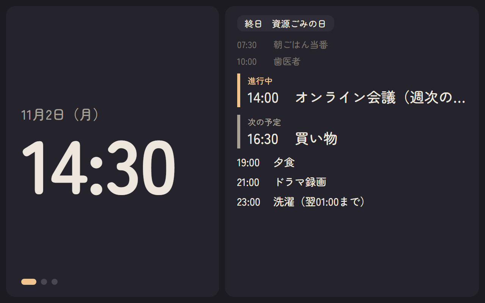
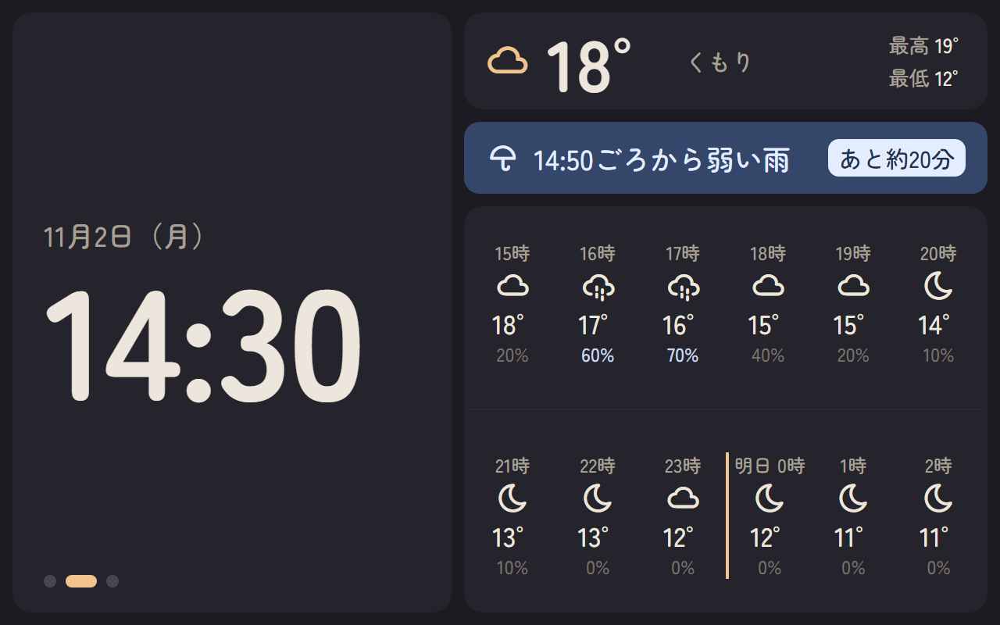
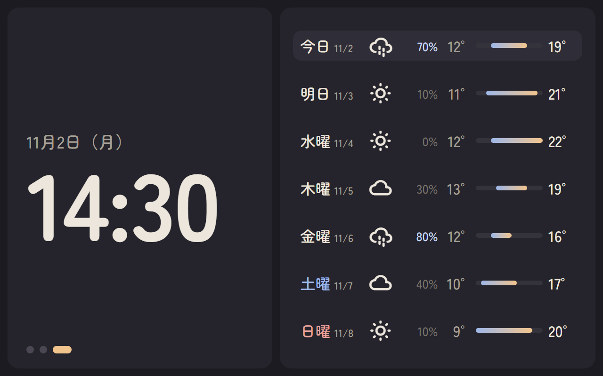
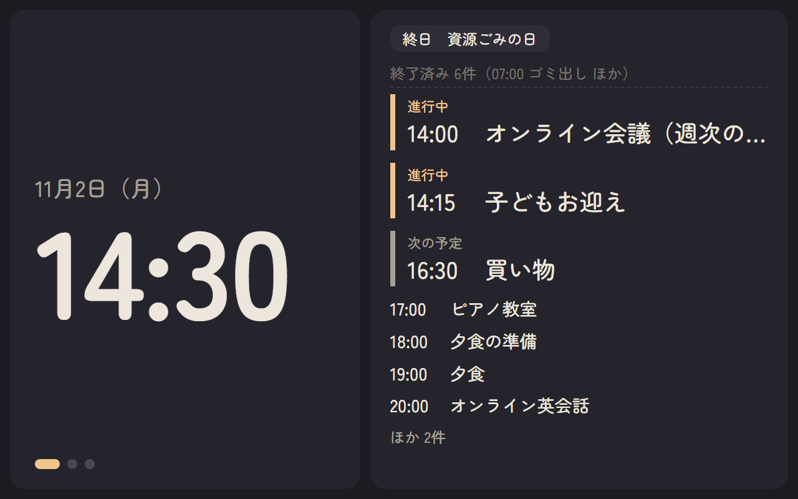
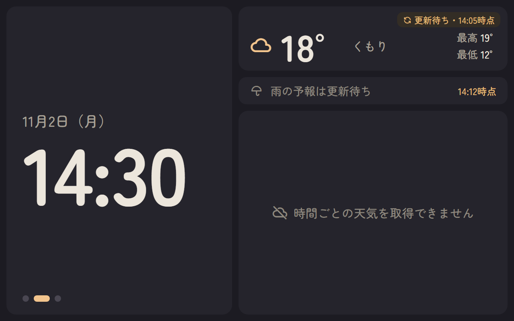
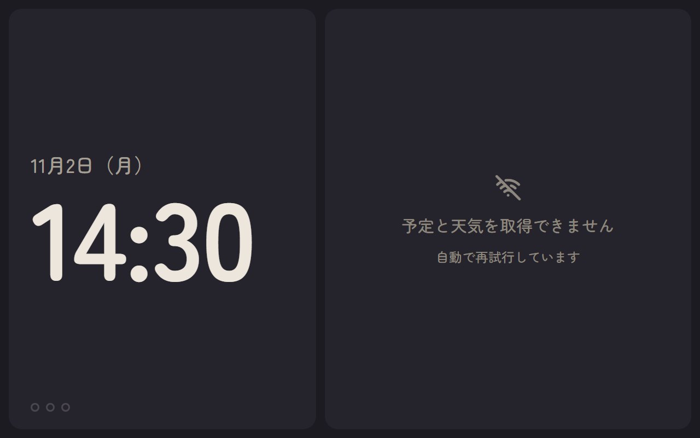
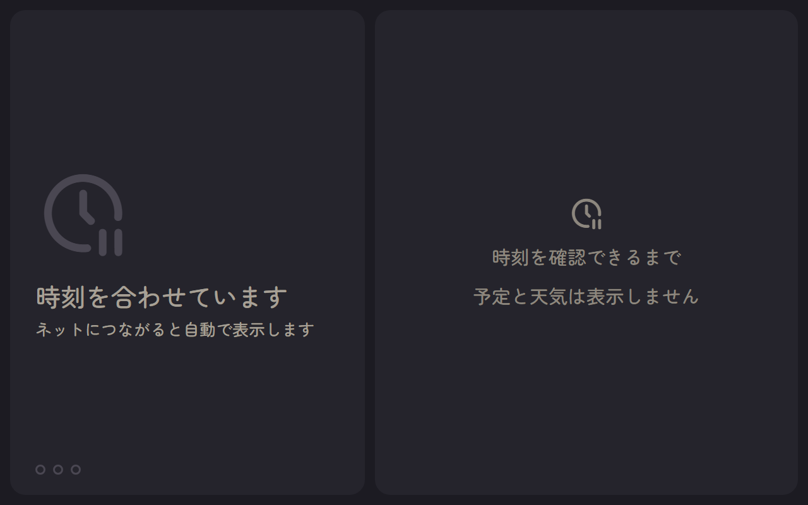
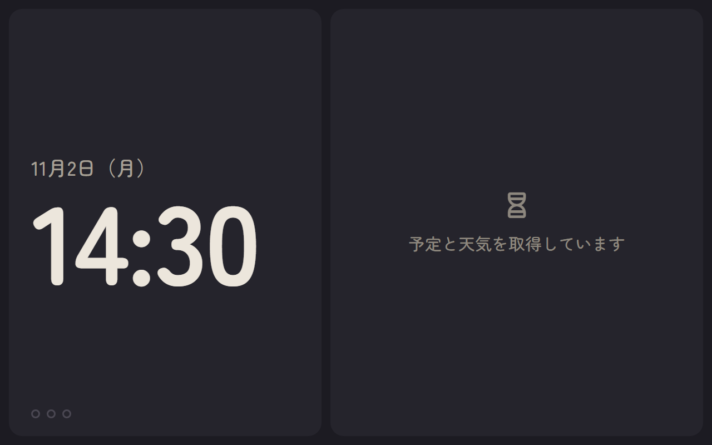
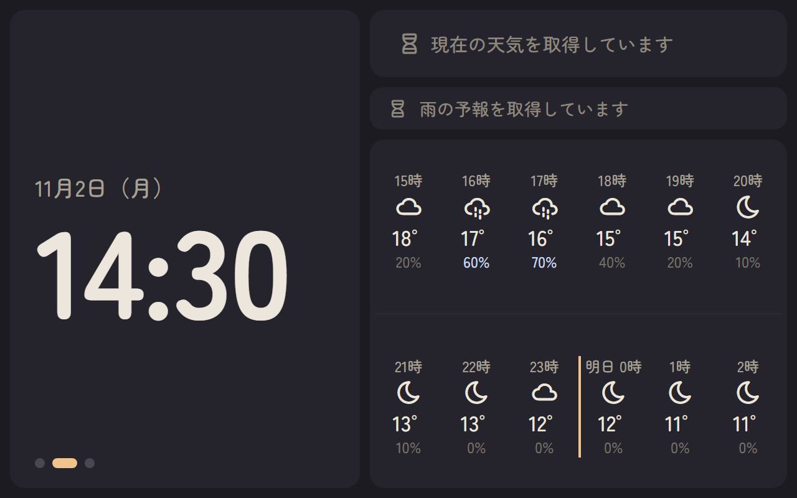

# UI設計

## 1. このドキュメントの目的

Issue #5「サイネージ画面のUIを設計する」の検討経過と結論を記録する。
状態：MVPの基本UI仕様を決定（2026-11-02）。個別の細部は暫定採用とし、第11章に示す。実装はIssue #7、実機での視認性・表示時間の確認はIssue #13で行う。

論点 → 選択肢 → 判断 → 理由を残す。px・色などの数値は1280×800での目安とし、実機確認で調整する。

### 1.1 関連文書と役割

- [要件定義](requirements.md)：MVPの表示内容・通常／異常時の基本動作。UIはこれに従う。
- [アーキテクチャ](architecture.md)：Display Component / Layout / ContentSwitcherの責務、Published Stateの利用。
- [技術スタック選定](technology-stack.md)：表示用APIの契約（第10章）、各StateのDomain DataとFrontend表示方針（第18〜22章）。
- [ハードウェア検討](hardware.md)：ディスプレイ（10.1インチ・1280×800・IPS）。
- 本書：画面の見た目・配置・各コンテンツの表示ルール・異常時の表示の正本。

本書はBackend・API契約を変更しない。時間別天気の表示範囲のみ要件を変更した（第9章）。

MVPの初期仕様として採用し、実機確認で見直す前提の項目は、本文に「（暫定採用）」と記し、第11章にまとめる。画面のモックと画面画像は第13章を参照する。

## 2. 前提（既存文書で確定済み）

| 項目   | 内容                                                                                                                                          |
| ------ | --------------------------------------------------------------------------------------------------------------------------------------------- |
| 画面   | 10.1インチ・1280×800・横置き・IPS。タッチ操作なし                                                                                             |
| 構成   | 時計・日付・曜日を常時表示。「今日の予定 → 今日の天気 → 週間天気」を固定順で自動切替（R-04）                                                  |
| 時計   | `11月2日（月） 14:30`形式、24時間表記、秒なし。未同期時は時刻を表示しない（R-01）                                                             |
| 視認性 | 時計は約3mで判読必須。現在の天気・気温は約3mで概要把握。その他は意識して見て判読できればよい（R-05）                                          |
| 予定   | 当日の全予定のリスト。開始時刻＋タイトル、日付またぎのみ終了時刻。終日は別枠、終了済みは薄く、進行中＋次の1件を大きく（R-02）                 |
| 異常時 | 正常時は注記なし。取得失敗＋有効Cacheは更新状態＋最終更新日時。期限切れ・初回未取得は取得失敗表示（R-07）                                     |
| データ | 表示用APIの5 State（schedule・currentWeather・hourlyWeather・rainForecast・weeklyWeather）。各`data`と共通`meta`（technology-stack.md第10章） |

## 3. 利用環境とデザインコンセプト

### 3.1 利用環境

- リビングに設置し、夜も常時点灯する。寝る場所からも見える。
- 画面の自動輝度調整はFuture。夜間のまぶしさは配色で抑える。

### 3.2 コンセプト

**柔らかいダーク・タイル**：暗めの落ち着いた画面に、角の丸いタイルで情報を区切る。時計を最も大きく見せる。

| 項目     | 決定                                                          | 理由                                                                                                       |
| -------- | ------------------------------------------------------------- | ---------------------------------------------------------------------------------------------------------- |
| テーマ   | ダーク（純黒・純白を避ける）                                  | 夜も点灯し寝る場所から見えるため、まぶしさと強すぎるコントラストを避ける                                   |
| スタイル | タイル（B1 ソフト・タイル）。背景より少し明るいタイルで区切る | 区切りが明確で、異常時の注記をタイル内に収めやすい。将来の配置カスタマイズ（タイル単位）と見た目が一致する |
| 雰囲気   | 柔らかい。丸ゴシック・大きめの角丸・暖色寄りのアクセント      | 家庭のリビングになじませるため                                                                             |
| 情報密度 | 低め。1タイル1テーマ、余白を広めにとる                        | 離れた位置から目に入る情報を絞るため                                                                       |

### 3.3 カラー（目安）

| 用途       | 色                                                                                  |
| ---------- | ----------------------------------------------------------------------------------- |
| 背景       | `#1c1b22`（暖色寄りの濃いグレー）                                                   |
| タイル     | `#25242c`、強調タイル `#2f2d37`                                                     |
| 文字       | 主 `#ece6dc`（生成り）、補助 `#a7a096`、薄い（終了済み等） `#77716a`                |
| アクセント | `#f2c48d`（淡いオレンジ。進行中の予定・現在のコンテンツ・天気アイコン・日付の境目） |
| 雨         | 帯 `#34476a`／文字 `#e3edff`、降水確率50%以上 `#c9d8f2`                             |
| 更新待ち   | 文字 `#e3b874`、札の背景 `#332d25`                                                  |
| 土曜・日曜 | `#9db7e8`・`#e8a39d`                                                                |

色は実装時にCSS変数として一か所で管理する。

### 3.4 フォント・アイコン・形

| 項目     | 決定                                                   | 理由・補足                                                                                              |
| -------- | ------------------------------------------------------ | ------------------------------------------------------------------------------------------------------- |
| フォント | Zen Maru Gothic（仮）。M PLUS Rounded 1cを実機で比較可 | 柔らかさと数字の読みやすさ。どちらもSIL Open Font License。オフラインでも表示できるようアプリに同梱する |
| 数字     | 等幅数字（`font-variant-numeric: tabular-nums`）       | 時刻・時刻列の桁がずれないようにする                                                                    |
| アイコン | 線画で角の丸いアイコン（試作ではTabler Icons）         | 柔らかい雰囲気と統一感。将来のキャラクター追加（Future）にもなじませる                                  |
| 角丸     | タイル24px、帯・札14〜20px                             | 柔らかさ                                                                                                |
| 背景     | 単色。写真・グラデーション背景は使わない               | 判読性と実装の簡単さ。写真はFuture                                                                      |

## 4. 画面レイアウト

### 4.1 構成（L1：左に時計）

```text
┌──────────────┬───────────────────┐
│              │                   │
│ 11月2日（月）│   コンテンツ領域   │
│              │ （予定／今日の天気 │
│   14:30      │   ／週間天気）     │
│              │                   │
│ ●━ ○ ○       │                   │
└──────────────┴───────────────────┘
   約45%              約55%
```

| 項目                 | 決定（1280×800での目安）                                                              |
| -------------------- | ------------------------------------------------------------------------------------- |
| 外周余白・タイル間隔 | 16px                                                                                  |
| 時計タイル           | 左45%。日付（約36px）と時刻（約200px、太字）を2段。下部にコンテンツ位置インジケーター |
| コンテンツ領域       | 右55%（約680×768px）                                                                  |
| インジケーター       | 3つの点。表示中のコンテンツは横長のアクセント色、巡回から外れたコンテンツは白抜き     |

時計の寸法の考え方：

- 約200pxは文字サイズ（CSSの`font-size`）であり、数字そのものの高さではない。Zen Maru Gothicでは、数字の高さは約145pxになる（試作で計測）。
- このディスプレイ（10.1インチ・1280×800）は約149ppiで、1pxは約0.17mm。数字の高さ約145pxは実寸で約2.5cmになる。
- 掲示物の一般的な目安として「約3m（10フィート）の距離に対して文字高約2.5cm（1インチ）」があり、これに近い値として仮に置いた。判読できることを保証する値ではない。
- 約3mからの判読性はIssue #13の実機検証で確認し、必要ならサイズを調整する。

**判断理由**：予定は時刻順のリストで縦長の領域が読みやすい。時計を左に置くと掛け時計としての存在感も出る。

**比較した案**：L2（上部に横長の時計帯、下にコンテンツ）。週間・時間別は横に並べやすいが、予定が2列に分かれ時刻順に読みにくい。

### 4.2 コンテンツの切替

- 順序・表示単位はR-04のとおり。表示時間の初期値は各コンテンツ10秒とし、実機で調整する（R-04、暫定採用）。
- 切替の動き：**フェード＋少し上へ**（新しい画面が下から約40px浮き上がりながら現れ、前の画面は少し上へ抜けながら消える。約0.6秒）。
- インジケーターの点は幅と色の変化で現在位置を移す（約0.5秒）。

## 5. コンテンツ別の表示仕様

### 5.1 今日の予定

| 対象                             | 表示                                                                                                                |
| -------------------------------- | ------------------------------------------------------------------------------------------------------------------- |
| 終日予定                         | 一覧の先頭にチップ（`終日　資源ごみの日`）で横に並べる                                                              |
| 終了済み                         | 小さめ・薄い色                                                                                                      |
| 進行中                           | 大きく表示し、左にアクセント色の線と「進行中」ラベル。最大2件。3件目以降は通常サイズ                                |
| 次に始まる1件                    | 大きく表示し、補助色の線と「次の予定」ラベル。同時刻開始が複数ある場合は先頭1件のみ大きくし、残りは直後に通常サイズ |
| それより後                       | 通常サイズ                                                                                                          |
| 日付またぎ（当日中に終わらない） | タイトルの後に`（翌01:00まで）`                                                                                     |
| 前日から続く予定                 | 時刻欄に`前日`、タイトルの後に`（09:00まで）`（暫定採用）                                                           |
| 長いタイトル                     | 1行に収め、はみ出す部分は`…`で省略                                                                                  |
| 予定なし                         | 「本日の予定はありません」（R-02）                                                                                  |

**Issue #10で補足した表示**（上表に記載のない場合。実機で確認する）：

| 対象                                            | 表示                                                                                                                                        |
| ----------------------------------------------- | ------------------------------------------------------------------------------------------------------------------------------------------- |
| 2日後以降に終わる予定（前日から続く場合を含む） | タイトルの後に`（11/9 10:00まで）`のように終了日を付ける                                                                                    |
| 翌日0:00ちょうどに終わる予定                    | 当日中に終わる予定として扱い、終了時刻を付けない（上表の「当日中に終わらない」に当たらないため）                                            |
| 複数日の終日予定                                | 最終日が明日以降なら、チップに`（11/9まで）`を付ける。最終日は`endDateExclusive`の前日                                                      |
| タイトルが空                                    | `（タイトルなし）`                                                                                                                          |
| 同時刻・同じ日の予定の順番                      | 時刻指定は開始時刻、終日は開始日の順。同じ場合は予定のID順に固定し、更新のたびに入れ替わらないようにする（「次の予定」の1件も同じ順で選ぶ） |

**件数が収まらない場合**（12件前後が目安）：

1. 終了済みを1行にまとめる：`終了済み 6件（07:00 ゴミ出し ほか）`
2. それでも収まらなければ、末尾から省いて`ほか N件`を表示する

一覧のページ送り・スクロールは行わない（R-02）。

**R-02との整合**：

- R-02は当日の全予定を対象とし、終了済みは薄く表示すると定めている。一方、「画面内の最大表示件数と、全件が収まらない場合の表示方法」はIssue #5へ引き継がれており、「非表示や件数だけの表示への置き換え」も当時は決めていなかった（requirements.md R-02）。
- 本ルールはその引き継ぎ事項に対する決定であり、ユーザーが承認した（2026-11-02）。収まる場合は従来どおり全件を表示する。集約・省略は、画面に収まらない場合に限る例外である。
- 集約・省略しても対象から外すわけではなく、件数で存在を示す。進行中と次の予定は省略の対象にしない。
- 省略は時刻の遅い予定から行う。そのため、件数超過時は夜の予定が画面で読めなくなる。この影響は、実機と実際の予定件数で確認する。

**表示の目安**：通常行 約28px、大きく表示する行 約38px、終了済み 約24px。

### 5.2 今日の天気

縦に3段で構成する。

| 段                 | 内容                                                                                      |
| ------------------ | ----------------------------------------------------------------------------------------- |
| 上段（現在の天気） | 天気アイコン・現在気温（約92px）・天気名を横一列。右端に`最高 19°`／`最低 12°`を2行で表示 |
| 中段（降雨）       | 1行の帯。必ず1行に収める                                                                  |
| 下段（時間別）     | 将来12時間を6枠×2段                                                                       |

**最高・最低気温**：WeeklyWeatherの今日（JST）の値を使う。WeeklyWeatherが利用できない場合は表示しない。

**降雨の文言（仮）**：

| RainForecastの状態         | 表示                                                  |
| -------------------------- | ----------------------------------------------------- |
| dry・`rainStartAt`あり     | `14:50ごろから弱い雨`＋右端に`あと約20分`             |
| raining・`rainEndAt`あり   | `普通の雨　15:40ごろやむ見込み`                       |
| raining・`rainEndAt`がnull | `弱い雨　しばらく続く見込み`                          |
| dry・降雨イベントなし      | `1時間以内の雨の予報はありません`（控えめな灰色の帯） |

- 強さは`intensity`の`light`・`moderate`・`heavy`を「弱い雨」「普通の雨」「強い雨」と表示する（technology-stack.md 21.4）。
- 時刻は5分単位に丸めて「ごろ」を付ける。「あと約N分」も5分単位に丸め、5分未満は「まもなく」とする（暫定採用）。
- 雨が見込まれるときは帯を濃い青で目立たせ、予報がないときは控えめにする。
- **経過時間の扱い（案。Issue #93の実装前に確認する）**：`status`はFrontendで変更しない（technology-stack.md 21.6）。「あと約N分」は表示中も現在時刻から再計算し、上の丸めを適用する。`rainStartAt`・`rainEndAt`を過ぎた場合は降雨状態を推測せず、帯に`予報時刻を過ぎました`と更新待ちを示す（文言は仮。1行に収まるかを実機で確認する）。取得から10分以上の予報は、これとは別に非表示にする（6.1）。時刻の信頼性が不明な場合の扱いは#65で決める（technology-stack.md 21.9）。

**時間別天気**：

- 現在時刻の次の正時から**12枠**（正時ちょうどはその時刻を含む）を、6枠×2段で表示する。
- 各枠：時刻（`15時`）・天気アイコン・気温・降水確率。降水確率50%以上は雨の色で強調する。
- 日付が変わる枠は時刻を`明日 0時`とし、左にアクセント色の縦線を引く。
- 1枠の幅は約110px。

**出典表示**：パネルの下端に`Weather data by Open-Meteo.com`を小さい灰色の文字で表示する。Open-Meteoのデータの利用条件（CC BY 4.0）に従うため（technology-stack.md 16.6）。天気の情報と重ねず、視認性を妨げない位置に置く。具体的な文字サイズ・色は実装時に決める（2026-11-08、Issue #9）。

### 5.3 週間天気

- 今日から最大7日を、**1日1行**で縦に並べる。
- 各行：`今日`／`明日`／`水曜`＋日付（`11/4`）、天気アイコン、降水確率、最低気温、気温バー、最高気温。
- 気温バーは、表示する7日間の最低〜最高の幅に対する、その日の最低〜最高の位置を示す。
- 今日の行は強調タイル色。土曜は青、日曜は赤の文字。
- 降水確率50%以上は雨の色で強調する。
- パネルの下端に、5.2と同じ出典表示`Weather data by Open-Meteo.com`を置く。

**比較した案**：7列の縦並び。上下に余白が残り、横が詰まったため行表示へ変更した。

### 5.4 天気アイコン

Open-MeteoのWMOベースのweatherCodeを次の区分でアイコンへ対応付ける。

| weatherCode    | 区分                                                           |
| -------------- | -------------------------------------------------------------- |
| 0・1           | 晴れ（夜は月）                                                 |
| 2・3           | くもり                                                         |
| 45・48         | 霧                                                             |
| 51〜67・80〜82 | 雨                                                             |
| 71〜77・85・86 | 雪                                                             |
| 95〜99         | 雷雨                                                           |
| 上記以外       | 「天気不明」（取得失敗とは扱わない、technology-stack.md 19.5） |

- 現在の天気の昼夜は`isDay`で切り替える。
- HourlyWeatherには昼夜の情報がないため、時間別は18:00〜翌05:59を夜とする固定判定にする（暫定採用）。週間天気は昼のアイコンを使う。

## 6. 異常時・データがないときの表示

### 6.1 情報ごとの表示

| 状態                                   | 表示                                                                                                                                          |
| -------------------------------------- | --------------------------------------------------------------------------------------------------------------------------------------------- |
| 正常                                   | 注記なし                                                                                                                                      |
| 取得失敗＋有効Cacheあり（更新待ち）    | データはそのまま表示し、タイル右上に小さな札`↻ 更新待ち・14:05時点`を淡いオレンジで表示する。札の分だけタイル上部に余白を足し、内容と重ねない |
| 期限切れ・初回未取得（取得できません） | その部分だけアイコン＋`時間ごとの天気を取得できません`等を表示する。タイルの領域は空けたまま残し、配置を崩さない                              |
| 降雨：取得から10分以上30分未満         | 予報を隠し`雨の予報は更新待ち`＋時刻（technology-stack.md 21.6）                                                                              |
| 降雨：TTL30分以上                      | `雨の予報を取得できません`                                                                                                                    |
| 予定：取得できない                     | `予定を取得できません`（「本日の予定はありません」と区別する）                                                                                |
| 天気コード不明                         | アイコンを「？」、天気名を`天気不明`                                                                                                          |

- 最終更新時刻は`meta.dataUpdatedAt`を使う。同じ日は`14:05時点`、日付が異なる場合は`11/1 23:50時点`とする。
- 降雨帯の更新待ちは、帯の右端に`↻ 更新待ち`／`14:12時点`を2行で表示する。

### 6.2 巡回への参加（E2）

| 状況                                                                                                                     | 動作                                                                                                                  |
| ------------------------------------------------------------------------------------------------------------------------ | --------------------------------------------------------------------------------------------------------------------- |
| コンテンツの情報が一部でも表示できる                                                                                     | 巡回に残す（「今日の天気」の部分取得失敗を含む、R-04）                                                                |
| コンテンツ全体が表示できない（予定：data:null、週間天気：将来0日、今日の天気：現在天気・時間別・降雨のすべてが表示不可） | 巡回から外し、インジケーターの点を白抜きにする                                                                        |
| すべてのコンテンツが表示できない                                                                                         | 巡回を止め、コンテンツ領域に1枚だけ`予定と天気を取得できません`／`自動で再試行しています`を表示する。時計は通常どおり |
| 取得に成功した                                                                                                           | 操作なしで巡回・通常表示に戻る（R-07）                                                                                |

**判断理由**：R-04の「一律に残す／飛ばすとしない」に合わせ、有効な情報があるコンテンツは残し、見る価値のない画面だけを外す。夜間にエラー画面が繰り返し出ることを避ける。表示可否の判定はarchitecture.md 15.3の表示可否Interfaceで実装する。

**比較した案**：E1（取得できなくても巡回に残し、取得失敗画面を表示する）。実装は単純だが、3回に1回エラー画面になる。

### 6.3 時刻未同期

「時刻未同期」は、OS / RTCが現在時刻を明確に利用不能と示す状態を指す（architecture.md 10.2）。ネットワークに接続できないだけで、RTCの時刻が利用できる場合は含まない。

**時計タイル**：日付と時刻を表示しない。大きな時計アイコン（暗い色）と`時刻を合わせています`／`ネットにつながると自動で表示します`を表示する。利用可能な時刻が得られたら、操作なしで通常の時計表示へ移る（R-01）。

**予定・天気の表示可否（既存契約との照合）**：

- Frontendは`now < expiresAt`のデータだけを表示する（technology-stack.md 7.3・10.8）。予定は、`data.date`がJSTの今日と一致することも照合する。時間別天気は「次の正時から」、週間天気は「今日から」を現在時刻で選ぶ（20.5・22.5）。
- これらの判定の基準はSystem Timeである（architecture.md 10.4）。そのため、時刻が利用不能なときは、データの有効期限も「今日」も判定できない。
- したがって、時刻未同期の間は予定・天気を表示しない。有効期限を確認できないデータを表示しないという既存原則からの帰結である。
- このとき、コンテンツ領域には`時刻を確認できるまで`／`予定と天気は表示しません`を1枚表示し、巡回を止める（暫定採用）。
- 時刻が利用可能になったら、各Stateの有効期限を評価し直し、操作なしで通常の巡回へ戻る。

**時刻が利用可能になったときの移り方**：

- 時計タイルは、日付と時刻をフェード（約0.6秒、コンテンツ切替と同じ速さ）で表示する。
- コンテンツは、表示できるものから巡回を始める。最初は「今日の予定」から始め、表示できなければ次へ進む（6.2）。切替の動きは4.2と同じ。

**比較した案**：

- `--:--`表示。丸ゴシックではハイフンが丸い棒になり、見た目が整わないため採用しない。
- 未同期中も巡回を続ける（初版の記述）。有効期限を判定できないデータを表示することになり、既存契約と整合しないため改めた。

### 6.4 表示用APIの取得失敗・503

表示用APIへのHTTP取得の失敗（503を含む）は、Polling失敗として扱う（technology-stack.md 7.3・10.9）。

- 最後に正常取得したResponseを保持し、各Stateの有効期限評価を続ける。期限内のデータは表示を続ける（architecture.md 5.6）。
- Polling失敗だけを理由に、全コンテンツ取得不可の画面へ切り替えない。
- 期限に達したStateから順に、6.1の「取得できません」になる。すべてのコンテンツが表示できなくなった時点で、6.2の1枚表示になる。
- HTTP取得失敗は、Backendの`lastAttemptResult`へ反映しない（7.3）。そのため、保持データの`meta`が直近の取得成功を示している間は、「更新待ち」の札も出ない。
- 有効なデータが残っている間は、Polling失敗そのものを画面に通知しない（暫定採用、第11章）。

**初版からの修正**：初版では「503は全コンテンツ取得不可と同じ表示」としていたが、保持データの継続利用を定めた既存契約と食い違うため改めた。

### 6.5 起動直後・初回取得中（ローディング表示）

R-07は「初回取得処理中の表示」をIssue #5で具体化するとしている（requirements.md R-07「後続設計で具体化する事項」）。本節はその決定である。「まだ取得を試していない」状態と、「試したが失敗した」状態を分けて表示する。

| 状態                                                       | 判定（既存のAPI・Metadataのみを使う）                                          | 表示                                                                                         |
| ---------------------------------------------------------- | ------------------------------------------------------------------------------ | -------------------------------------------------------------------------------------------- |
| 表示用APIの最初の応答を待っている                          | 起動後、最初のPollingが完了していない（Timeoutは5秒、technology-stack.md 7.3） | コンテンツ領域に1枚だけ`予定と天気を取得しています`                                          |
| 外部データの初回取得を待っている                           | `data: null`かつ`meta.lastAttemptAt: null`（完了した取得試行がまだない）       | その部分に`○○を取得しています`。例：`現在の天気を取得しています`、`雨の予報を取得しています` |
| 初回取得を試したが失敗した                                 | `data: null`かつ`meta.lastAttemptAt`が非null                                   | 6.1の「取得できません」（R-07の初回未取得）                                                  |
| 表示用APIに一度もつながらないまま、最初のPollingが失敗した | 保持しているResponseがない                                                     | 6.2の全コンテンツ取得不可の1枚表示                                                           |

- 取得中の部分は、データを表示しない。巡回への参加は6.2と同じ扱いで、コンテンツ全体が取得中なら巡回から外す。
- すべてのStateが取得中のときは、コンテンツ領域に`予定と天気を取得しています`を1枚表示する。一部でも「取得できません」があれば、6.2の全取得不可の表示を優先する。
- Stateが`states`から省略されている（未公開、technology-stack.md 10.7）場合は、取得中とは扱わず「取得できません」とする。
- **暫定（Issue #9〜#93）**：RainForecastはIssue #93まで本番で未実装のため、`rainForecast`は常に省略され、降雨帯は`雨の予報を取得できません`になる。上の「一部でも『取得できません』があれば全取得不可を優先」の判定では、このように**本番で未実装と明示したStateを数えない**。数えると、起動のたびに初回取得までの間`予定と天気を取得できません`が出るため。実装済みのStateの取得失敗・省略は除外しない。#93でRainForecastを本番に登録するときも、この除外はなくさず、`rainForecast`を取得中の判定に数えない扱いを恒久にする（2026-11-09。案。承認後に確定）。Tomorrow.io未設定・Secret不正・Provisioning未完了・Trust成立前は`rainForecast`が省略されたままになり、数えると起動直後が「取得できません」になるため。API契約は拡張しない。降雨帯は個別に`雨の予報を取得できません`等を表示する（technology-stack.md 21.9）。
- 表示はアイコン（砂時計）と文字だけにする。回転するスピナー等の常時動く演出は使わない（第7章）。
- 時計は、取得を待たずに表示する（R-06）。

**比較した案**：ローディング専用の表示を設けず、起動直後から「取得できません」と表示する。R-07の初回未取得の文言どおりだが、電源投入のたびに数十秒〜数分「取得できません」が出て、故障と誤解しやすいため採用しない。

### 6.6 認証・設定の再設定が必要な場合

- 表示用APIの共通Metadataには、エラーの種類（`errorCode`等）を含めない方針である（technology-stack.md 10.6・18.5）。そのため、Frontendは認証・設定の失敗と、通信などの一時的な失敗を区別できない。
- MVPでは専用の表示を設けない。認証・設定に起因する取得失敗も、通常の取得失敗と同じく「更新待ち」→「取得できません」で表示する（6.1）。
- 認証失効・設定不備の検知と対応は、開発者がログ・状態確認で行う（R-09、technology-stack.md 18.5）。
- 利用者向けの専用表示はFutureとする（第10章）。追加する場合は、表示用APIにエラーの分類を加える設計変更が必要になる。

**比較した案**：専用の表示を作る。表示用APIの契約変更が必要になり、本Issueの前提（Backend・API契約を変更しない）に反するため採用しない。

## 7. アニメーションの方針

| 対象             | 方針                                                            |
| ---------------- | --------------------------------------------------------------- |
| コンテンツの切替 | フェード＋少し上へ（約0.6秒）。`opacity`と`transform`のみを使う |
| インジケーター   | 幅と色の変化（約0.5秒）                                         |
| 常に動く演出     | 使わない（時刻のコロン点滅、背景アニメーション等）              |

`opacity`・`transform`はGPUで合成されやすく、Raspberry Pi 5でも負荷が小さい見込み。実機の滑らかさはIssue #13で確認する。

## 8. 実機検証（Issue #13）への引き継ぎ

- 時計（font-size約200px、数字の高さ約2.5cm）：約3mから明確に判読できるか。
- 現在気温約92px・天気アイコン：約3mで概要を把握できるか。
- 予定・時間別・週間天気：意識して見て判読できるか。終了済み・薄い色の判読性。
- 夜間のまぶしさ、日中の見やすさ（輝度の設定値を含む）。
- 切替アニメーションの滑らかさ、CPU負荷。
- コンテンツの表示時間。
- フォント（Zen Maru Gothic／M PLUS Rounded 1c）の最終選定。

## 9. 要件の変更：時間別天気を将来12時間へ

| 項目       | 内容                                                                                                                                                                                                   |
| ---------- | ------------------------------------------------------------------------------------------------------------------------------------------------------------------------------------------------------ |
| 変更前     | 翌日を含む将来24時間（次の正時から24枠）を表示（R-03、2026-10-13）                                                                                                                                     |
| 変更後     | 将来12時間（次の正時から12枠）を表示                                                                                                                                                                   |
| 理由       | 24枠を1画面に収めると1枠が小さくなり読みにくい（12枠×2段で1枠約55px、8枠×3段で約84px）。サイネージで時間別を見るのは外出前・就寝前が中心で、夜は翌朝まで確認できる。翌日の日中の見通しは週間天気で補う |
| 比較した案 | 12枠×2段（24時間）、8枠×3段（24時間）、直近6時間を大きく＋残り18時間を小さく、3時間ごと（1時間ごとの要件に反するため不採用）                                                                           |
| 影響       | Frontendの選択枠数のみ。Backendの保持範囲（最大36枠）・採用時の24枠検証・API契約は変更しない                                                                                                           |

## 10. Future

- 雨雲レーダー（地図）を降雨情報と合わせた独立コンテンツにする。MVPは地図なしで「今日の天気」に含める（R-03・R-04）。独立させる場合はR-04の変更として扱う。
- シンボルキャラクター（猫）を画面に自由に配置する遊び要素。
- 時間帯によるライト／ダーク切替、画面の自動輝度調整。
- 利用者による配置・サイズ・コンテンツの変更（R-11）。タイル構造をその単位として使う。
- 認証・設定の再設定が必要なことを利用者に知らせる専用表示（6.6）。表示用APIにエラー分類を追加する設計変更とあわせて検討する。

## 11. 暫定採用した仕様

文書化の際に仮置きし、PR #58のレビューを経て2026-11-02にMVPの初期仕様として採用した項目。実機確認や運用で問題があれば見直す。

| No. | 事項                         | 採用内容                                                                      | 見直しの観点                               | 該当箇所 |
| --- | ---------------------------- | ----------------------------------------------------------------------------- | ------------------------------------------ | -------- |
| 1   | 降雨の時刻の丸め             | 時刻と「あと約N分」を5分単位に丸め、5分未満は「まもなく」                     | 実際の予報で違和感がないか                 | 5.2      |
| 2   | 前日から続く予定             | 時刻欄に`前日`、タイトルの後に終了時刻`（09:00まで）`                         | 終了日を誤認しないか                       | 5.1      |
| 3   | 時間別天気の夜アイコン       | 18:00〜翌05:59を夜とする固定判定                                              | 季節による日の出・日の入りとのずれ         | 5.4      |
| 4   | 表示時間の初期値             | 各コンテンツ10秒                                                              | 実機で読み切れるか、待ち時間が長すぎないか | 4.2      |
| 5   | 時刻未同期時のコンテンツ領域 | `時刻を確認できるまで`／`予定と天気は表示しません`を1枚表示し、巡回を止める   | 文言の分かりやすさ                         | 6.3      |
| 6   | Polling失敗の表示            | 有効なデータが残る間は通知しない。期限切れになったStateから「取得できません」 | 長時間の通信断に気付けるか                 | 6.4      |

初版で仮置きした「503時は全コンテンツ取得不可と同じ表示」は、既存契約と食い違うため撤回した（6.4）。

## 12. 実装時・実機で調整する事項

- 文言の最終調整（本書の文言はMVPの初期値）。
- 色の微調整、各文字サイズ。
- コンテンツの表示時間。
- 予定の1画面あたりの件数（実際の描画で収まるかを判定して集約する）。
- 降雨の「あと約N分」の再計算・予測時刻経過後の表示。
- 時間別の夜アイコンの判定方法。

## 13. UIモック

モックデータで動く単体HTMLを[ui-mock/signage-mock.html](ui-mock/signage-mock.html)に置く（2026-11-02）。既存のBackend・APIは使わない。

- ブラウザでファイルを開くと、操作パネルで各Stateの状態（取得中を含む）・時刻同期・切替の動き・表示時間を切り替えられる。
- URLパラメータで状態を指定できる。例：`signage-mock.html?view=W&cur=stale&capture=1`。`capture=1`は、1280×800の画面だけを表示し、自動切替を止める。
- 確認用に、フォントとアイコンはCDNから読み込む。本番ではアプリに同梱する。
- **本番実装（Issue #7）では外部CDNへの依存を残さない。** フォント・アイコンを含むすべての資源をアプリに同梱し、ネットワークに接続できない状態でも基本画面を表示できるようにする（R-06）。
- 現在時刻は2026-11-02（月）14:30に固定している。

主な画面（1280×800、`capture=1`で撮影）：

| 画面                                                                     | 画像                                                            |
| ------------------------------------------------------------------------ | --------------------------------------------------------------- |
| 今日の予定（通常）                                                       |               |
| 今日の天気（通常）                                                       |          |
| 週間天気（通常）                                                         |           |
| 予定の件数超過（16件）                                                   |  |
| 部分取得失敗（現在天気：更新待ち、降雨：10分超、時間別：取得できません） |      |
| 全コンテンツ取得不可                                                     |        |
| 時刻未同期                                                               |          |
| 起動直後（すべて取得中）                                                 |                  |
| 一部取得中（現在天気・降雨：取得中）                                     |        |

## 14. 決定事項一覧

| 日付       | 対象                     | 決定                                                                                      | 理由                                                                                                     |
| ---------- | ------------------------ | ----------------------------------------------------------------------------------------- | -------------------------------------------------------------------------------------------------------- |
| 2026-11-02 | テーマ                   | ダークのソフト・タイル（B1）                                                              | 夜間のまぶしさを抑え、区切りを明確にし、将来のタイル単位のカスタマイズと一致させるため                   |
| 2026-11-02 | フォント                 | Zen Maru Gothic（仮）、同梱                                                               | 柔らかさと数字の読みやすさ。オフライン表示のため                                                         |
| 2026-11-02 | レイアウト               | 左45%に時計、右55%にコンテンツ（L1）                                                      | 予定のリストを縦長に読めるため                                                                           |
| 2026-11-02 | 予定の表示ルール         | 第5.1節のとおり                                                                           | 進行中・次の予定を見つけやすくし、件数超過時もページ送りなしで収めるため                                 |
| 2026-11-02 | 今日の天気の構成         | 現在の天気を横一列、降雨を1行の帯、時間別を6枠×2段                                        | 現在の天気を主役にし、降雨を目に入りやすくするため                                                       |
| 2026-11-02 | 時間別天気の範囲         | 将来12時間（要件変更）                                                                    | 第9章のとおり                                                                                            |
| 2026-11-02 | 最高・最低気温           | 今日の天気に表示（WeeklyWeatherの今日を利用）                                             | 追加の取得なしで1日の見通しが分かるため                                                                  |
| 2026-11-02 | 週間天気                 | 1日1行の7行表示                                                                           | 余白と横の詰まりを解消するため                                                                           |
| 2026-11-02 | 異常時の表示             | 第6章のとおり。巡回はE2                                                                   | 有効な情報を残しつつ、表示できない画面を繰り返さないため                                                 |
| 2026-11-02 | 時刻未同期               | 時計アイコン＋案内文                                                                      | `--:--`より見た目が整うため                                                                              |
| 2026-11-02 | アニメーション           | フェード＋少し上へ、常時動く演出なし                                                      | 切替を自然に伝え、夜に気にならないようにするため                                                         |
| 2026-11-02 | 降雨の位置               | MVPは今日の天気に含める。雨雲レーダーと独立コンテンツ化はFuture                           | 地図なしでは独立画面の情報が少なく、巡回の待ち時間も増えるため                                           |
| 2026-11-02 | 503・Polling失敗         | 保持データを期限内は表示し続ける。有効なデータが残る間は通知しない                        | 既存契約（technology-stack.md 7.3・10.9）に合わせるため。PR #58レビューで修正                            |
| 2026-11-02 | 時刻未同期時のコンテンツ | 予定・天気を表示せず、1枚の案内を表示                                                     | 有効期限と「今日」を判定できないため。PR #58レビューで修正                                               |
| 2026-11-02 | 暫定採用の細部           | 第11章の6項目                                                                             | 実機確認を前提に、MVPの初期仕様として採用                                                                |
| 2026-11-02 | ローディング表示         | 取得試行前は「取得しています」、試行後の失敗は「取得できません」と分ける（6.5）           | 起動のたびに「取得できません」と表示され、故障と誤解されるのを避けるため。既存のMetadataだけで判定できる |
| 2026-11-02 | 認証・設定の再設定       | MVPでは専用表示なし。通常の取得失敗と同じ表示。検知はログで行う（6.6）                    | 表示用APIにエラー分類がなく、API契約を変更しないため                                                     |
| 2026-11-02 | 時刻同期後の移り方       | 時計はフェードで表示し、表示できるコンテンツから巡回を再開（6.3）                         | 切替と同じ動きを使い回し、実装を増やさないため                                                           |
| 2026-11-02 | 本番の外部資源           | フォント・アイコンを同梱し、外部CDNに依存しない                                           | オフラインでも基本画面を表示するため（R-06）                                                             |
| 2026-11-08 | 天気の出典表示           | 今日の天気・週間天気のパネル下端に`Weather data by Open-Meteo.com`（5.2・5.3）            | Open-Meteoのデータの利用条件（CC BY 4.0）に従うため。Issue #9                                            |
| 2026-11-08 | 未実装Stateの扱い        | 起動直後の判定で、本番で未実装と明示したState（#93までの`rainForecast`）を数えない（6.5） | 起動のたびに「取得できません」と出るのを避けるため。Issue #9                                             |
